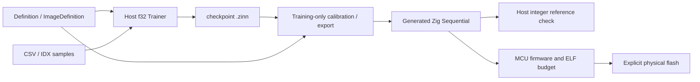

# Concepts and internals

## One definition, separate responsibilities

Definitions calculate shape/parameter layout/schema at comptime. Training uses f32 parameters, activations and SGD on the host. Export calibrates/quantizes and writes source; the MCU sees only statically typed integer layers and constant parameter arrays. It never parses a checkpoint/graph or trains. Host model/reference containers are not MCU runtime types. Only inference code referenced by firmware is instantiated/linked.

## Static workspaces and weights

Sequential calls layers directly. Input feeds the first layer without copying; final output writes directly to the caller. Intermediate parity buffers reserve only the maximum widths on each side. A single layer retains alias-safe scratch. Conv computes directly without im2col. Keep input/output separate from workspace; concurrent calls cannot share workspace. [Inference API](api/inference.md) owns the alias contract.

Weights are constants intended for Flash/rodata. Dense order is output-major; Conv order is output-channel/kernel-y/kernel-x/input-channel; activations are HWC. int4 stores two signed weights per byte, decodes on use and retains int8 activations. Full ELF accounting includes startup/runtime/HAL/transport/constants, while model parameter counts alone do not. Static globals/input/workspace/output plus a separate stack allowance must fit RAM. See [budgets](api/budgets.md).

## Integer arithmetic

An int32 accumulator sums bias plus (input-zero)×weight. Compile-time absolute-sum bounds prove all partial sums safe over the full i8 input domain. Requantization uses an i64 product with multiplier/2^shift, nearest ties away from zero and saturation. This costs code/time on RV32EC, not floating-point execution. Generated adjacent scale metadata shares exact f32 bits and is compile-time only. The authoritative formula, rounding examples, packed layout and scale contract are in [quantization](quantization.md).

## Checkpoint v1

Trainer.encode produces little-endian bytes:

| Offset | Contents |
|---|---|
| 0..8 | magic/version ZINNf32 followed by byte01 |
| 8..16 | u64 structure schema_tag |
| 16..20 | u32 seed |
| 20..24 | u32 optimizer update count (legacy field epochs) |
| 24..32 | reserved zero bytes on encode |
| 32.. | parameter_count f32 bit patterns, weights/bias in definition layout |
| final8 | u64 FNV-style checksum of preceding bytes |

Exact total32+4×parameter_count+8. Decoder rejects wrong length/magic/schema/checksum/nonfinite parameters before replacement. Checksum detects corruption, not malicious modification. v1 does not encode preprocessing, split seed, optimizer schedule or dataset identity: store those and learning curves as sidecars. No format change is made for documentation.

## Generated source and UART

Exporter emits Sequential with constant weight/bias arrays, explicit quantization/shape checks, model_id/schema_tag/input_scale/output_scale. Verification vectors may be appended for host/diagnostic tools; unused declarations are omitted from production firmware. Do not hand-edit generated coefficients; regenerate from the checkpoint and matching settings.

Production UART accepts already-quantized samples through a replaceable adapter and checks CRC/length/model/deadlines before inference. The canonical [wire reference](api/uart.md) and [tutorial](tutorials/uart.md) separate host simulation from physical exchange. CRC/model_id are not security boundaries; expose the serial interface only within a trusted application context.
