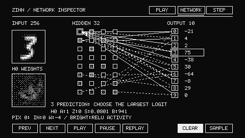
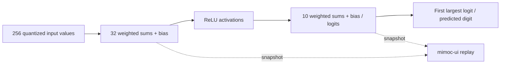

# MNIST network inspector

[日本語](mnist-inspector_ja.md) · [Try it in your browser](https://moribit.github.io/zinn-mnist-web/) · [Desktop example](../examples/mnist-desktop/README.md)

The inspector uses the same bundled **256 → 32 ReLU → 10 int8** model as PLAY.
It does not train, change weights or alter the classifier. All modes are drawn
by mimoc-ui into the same 480×272 Mono1 framebuffer on macOS and WebAssembly.
The only PLAY layout change is replacing the top-right heading with three mode
buttons; the drawing area, preview, prediction, score bars and controls retain
their sizes and positions. Below the header, the first-sample framebuffer is
checked against its pre-inspector pixel hash.



## Controls

- **PLAY**: draw a digit, CLEAR, or choose one of 16 SAMPLE inputs as before.
- **NETWORK**: inspect the input, 32 hidden neurons and ten digit outputs.
- **STEP**: PREV/NEXT move through Input, Hidden, Output, Prediction. PLAY/PAUSE
  control replay; REPLAY returns to Input. These controls also work in NETWORK.
- Click a hidden square to choose its neuron (row-major, H0–H31). The lower-left
  16×16 map shows its **actual 256 input weights**. Click a map cell to inspect
  its input value and weight in the bottom line.
- Click an output digit to show all its 32 incoming connections. First select a
  hidden square, then an output, to inspect that particular weight and output bias.
- Switch back to PLAY to edit the drawing. Input, logits and selected neuron are
  preserved across modes. A new stroke/sample replaces the snapshot and restarts
  replay; CLEAR clears activations and stops replay without changing the mode.
- Arrow keys navigate mimoc-ui buttons; Enter/Space activates. Browser Tab keeps
  normal page navigation. Escape/Backspace/Delete clears.

Replay reveals an already-computed snapshot over three 650ms intervals. There
is **no inference on animation frames**, and no idle redraw after completion.
A focus suspension is capped to a 100ms replay advance per tick, rather than
skipping the entire explanation on return.

## What the picture means

Every connection has a weight. Each neuron combines its inputs and produces an
activation. A **weight** determines how much an input contributes; a **bias** is
an additional learned offset. The hidden layer applies **ReLU**, replacing values
below real zero with zero. Its output is called an **activation**.

- Hidden squares use the actual post-ReLU int8 snapshot. `A` is its raw value,
  `Z` its zero point, `S` its real-value scale, and `B` the int32 bias in accumulator
  units. Real activation is `(A - Z) * S`.
- Outline-only means zero activity. Ordered dithering increases from the ReLU
  zero point to int8 127; white means the top of this quantized range. It is
  neither probability nor a normalized comparison between neurons.
- Input pixels use the actual quantized input and generated input scale.
  `PIX` identifies a row-major pixel; `IN` and `W` show its raw input and weight.
- Positive connections are solid, negative connections dashed. Zero weights
  have no line. Outside focus, weights below magnitude 32 are stippled and
  inactive hidden sources are omitted. By default each output contributes its
  two largest absolute weights (ties: smaller hidden index), plus the selected
  hidden neuron’s ten edges: **at most 30 lines**, not 8,512.
- Output focus shows its 32 edges. Focused connections remain visible even when
  their source is inactive, so weights can be inspected. Moving dots occur only
  on nonzero-weight connections from active sources.
- Weight-map magnitude is `min(255, 2 * abs(weight))`; negative weights additionally
  use checker hatching, positive weights use ordinary dithering. Map brightness
  describes **weight magnitude**, not activation. Bias real units are
  `bias * input_scale * weight_scale`; Dense exposes all scale metadata.
- Output numbers are the unchanged raw **logits**, not probabilities. The largest
  logit gives the prediction, with the original first-index tie break.

The input-to-hidden line is an aggregate illustration, not 8,192 literal lines.
Dots and staged reveals illustrate **calculation order**, not physical signal
travel or measured layer execution time. No score is invented for animation.
Numeric inspector text is English; localized documentation is available above.
Japanese UI glyphs/language switching are not implemented.



## Trace API and isolation

[Sequential](../src/model.zig) exposes `Model.Trace`, `trace_bytes`,
`layer_count`, `Layer(comptime index)`, and `inferTraced(input, output, workspace,
trace)`. A Trace owns one flat int8 array of **every layer output**; its
`layer(comptime index)` returns a typed read-only pointer. The example retains
its 256-byte input separately and uses a 42-byte trace (32 hidden + 10 output).
Trace, input, output and workspace must not overlap. Input/output retain the
ordinary aliasing contract. Each concurrent invocation needs separate mutable
buffers; weights are read-only.

Dense adds `weightAt(output, input)`, `biasAt(output)` and `quantization` read-only
accessors, including packed-int4 decoding. Parameters are output-major. Trace
copies the outputs of the **same kernel calls** used by ordinary `infer()`; it
never recomputes a layer. The observing/nonobserving path is chosen at compile
time. Unused trace types/accessors allocate no MCU storage and emit no tracing
code. No UI, float presentation math or animation enters the inference core.
See [API usage](api/inference.md).

[App](../examples/mnist-desktop/app.zig) owns trace/state;
[inspector](../examples/mnist-desktop/inspector.zig) owns presentation and pure
hit-testing/replay state. The [WASM adapter](https://github.com/moribit/zinn-mnist-web)
only forwards events/timestamps and displays the framebuffer; JavaScript does
not draw the neural network or run inference.

## Reproduce

No training, download or hardware is needed:

```sh
zig build --build-file examples/mnist-desktop/build.zig test
zig build --build-file examples/mnist-desktop/build.zig test -Doptimize=safe
zig build --build-file examples/mnist-desktop/build.zig run -Doptimize=safe
zig build --build-file examples/mnist-desktop/build.zig run -Doptimize=safe -- --snapshot-network /tmp/network.pbm
zig build --build-file examples/mnist-desktop/build.zig run -Doptimize=safe -- --snapshot-step /tmp/step.pbm
zig build --build-file examples/mnist-desktop/build.zig benchmark -Doptimize=safe
```

The last command measures host inference/framebuffer generation, **not monitor
FPS**. For browser builds/tests, follow the separate Web demo README. See the
[verification report](mnist-inspector-report.md) for measurements and limitations.
