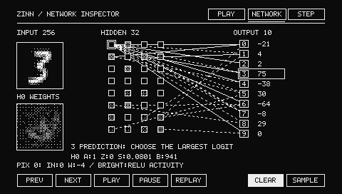
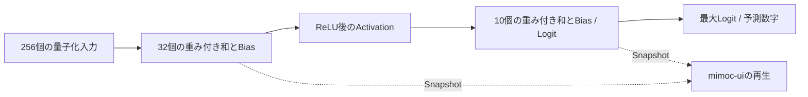

# MNISTネットワークInspector

[English](mnist-inspector.md) · [ブラウザで試す](https://moribit.github.io/zinn-mnist-web/) · [デスクトップ版](../examples/mnist-desktop/README.md)

PLAYと同じ学習済み **256 → 32 ReLU → 10、int8** モデルの内部を観察します。
学習・重みの変更・分類処理の変更は行いません。macOSとWASMは同じmimoc-uiの
480×272 Mono1画面を使います。PLAYの変更は右上の見出しを3つのモードボタンへ
置き換えた部分だけです。キャンバス・入力プレビュー・予測・Logitバー・既存ボタンの
位置と大きさを維持し、ヘッダーより下は変更前のSnapshotハッシュで検証します。



## 操作

- **PLAY**：従来どおり数字を描きます。CLEARで消去、SAMPLEで16件の入力を切り替えます。
- **NETWORK**：入力画像、32個のHiddenニューロン、10個の出力を表示します。
- **STEP**：PREV／NEXTでInput、Hidden、Output、Predictionを進めます。
  PLAY／PAUSEで再生・停止、REPLAYでInputへ戻ります。NETWORKでも同じ操作ができます。
- Hiddenの四角を選ぶと、そのニューロンの**実際の256個の入力重み**を左下の16×16マップへ
  表示します。番号は左上から行優先でH0〜H31です。マップの画素を選ぶと、下段に
  入力値と重みを表示します。
- 出力の数字を選ぶと、32本の入力結合を表示します。先にHidden、次にOutputを選ぶと、
  その結合の重みと出力Biasを下段で確認できます。
- 入力を描き直す場合はPLAYへ戻ります。モード切り替えでは画像・Logit・選択ニューロンを
  保持します。入力更新時はSnapshotを置き換えて再生を最初から開始します。
  CLEARは現在のモードを維持したままActivationと選択状態を初期化し、再生を停止します。
- 矢印キーでmimoc-uiボタンを移動し、Enter／Spaceで操作します。ブラウザのTabは通常の
  ページ移動を維持します。Escape／Backspace／Deleteで消去できます。

再生は**すでに計算済みのSnapshot**を650msずつ3段階で表示します。
アニメーションのフレームごとに推論せず、再生完了後は待機中の再描画も行いません。
画面のフォーカスが長時間失われた場合は、復帰時に説明を飛ばさないよう、
1 tickあたりの進行を最大100msに制限します。

## 表示の意味

各結合には重みがあり、ニューロンは入力を組み合わせて活性化の値を計算します。
**Weight（重み）**は入力が計算へ寄与する度合い、**Bias**は学習した補正値です。
Hiddenでは**ReLU**により実数のゼロより小さい値をゼロにします。その出力が
**Activation（活性化の値）**です。

- Hiddenの四角はReLU後の実際のint8値を使います。`A`は生の値、`Z`はゼロ点、
  `S`は実数スケール、`B`はint32積算単位のBiasです。実数のActivationは`(A - Z) * S`です。
- 非活性は輪郭だけ、強くなるほどディザリングが明るくなります。ゼロ点からint8の127までを
  表示範囲に使います。確率でも、ニューロン同士の相対順位でもありません。
- 入力画像は実際の量子化入力と生成済み入力スケールを使います。`PIX`は行優先の画素番号、
  `IN`と`W`はその画素の生の入力値と重みです。
- 正の結合は実線、負は破線です。重みゼロは線を描きません。通常表示では絶対値32未満を
  点描にし、非活性のHiddenからの線を省きます。各出力の絶対値上位2本と、選択Hiddenの
  出力10本を描くため、**最大30本**です。同じ絶対値ではHidden番号の小さい方を優先します。
- Outputを選ぶと、その出力への32本を表示します。選択対象の結合は非活性でも確認できます。
  移動する点は、活性化した入力元とゼロ以外の重みを持つ結合だけに表示します。
- 重みマップの明るさは`min(255, 2 * abs(weight))`です。負の重みには追加の市松模様を使い、
  正の重みは通常のディザリングにします。これは**重みの大きさ**で、Activationとは別です。
  Biasの実数値は`bias * input_scale * weight_scale`です。スケールはDenseのメタデータから取得できます。
- 出力は変更していない生の**Logit（出力スコア）**です。確率ではありません。
  最大値の数字を予測し、同点なら元と同じく番号の小さい方を選びます。

入力からHiddenへの線は8,192本を集約した説明図です。点の移動と段階表示は
**計算順序を説明する演出**であり、物理的な信号移動や実測した各層の処理時間ではありません。
演出のためのスコアは作りません。Inspector内の説明は英語です。
日本語UIの字形と言語切り替えは未実装です。



## Trace APIと推論の分離

[Sequential](../src/model.zig)に`Model.Trace`、`trace_bytes`、`layer_count`、
`Layer(comptime index)`、`inferTraced(input, output, workspace, trace)`を追加しました。
Traceは**全Layerの出力**をint8の1本の配列へ保存し、`layer(comptime index)`で
固定長の読み取り専用ポインタを返します。このExampleでは256Bの入力を別途保持し、
Traceは42B（Hidden 32 + Output 10）です。Traceは入力・出力・Workspaceと重ねられません。
入力と出力のalias規則は従来どおりです。同時実行では可変バッファをそれぞれ用意し、
読み取り専用の重みは共有できます。

Denseには`weightAt(output, input)`、`biasAt(output)`、`quantization`を追加しました。
packed int4も同じ読み取りAPIで扱えます。重みは出力ニューロン優先です。
Traceは通常の`infer()`と**同じカーネル呼び出しの出力**をコピーし、Layerを再計算しません。
観測の有無をコンパイル時に分岐するため、使わない型やアクセサーはMCUの保存領域や
Traceコードを増やしません。UI・表示用浮動小数点・アニメーションは推論コアへ入りません。
[API使用例](api/inference.md)も参照してください。

[App](../examples/mnist-desktop/app.zig)がSnapshotと状態を所有し、
[Inspector](../examples/mnist-desktop/inspector.zig)が描画・選択・再生を担当します。
[WASMアダプター](https://github.com/moribit/zinn-mnist-web)のJavaScriptは
入力と時刻の転送、Framebufferの表示だけを担当し、ネットワーク描画や推論は実装しません。

## 実行

データ取得・学習・実機は不要です。

```sh
zig build --build-file examples/mnist-desktop/build.zig test
zig build --build-file examples/mnist-desktop/build.zig test -Doptimize=safe
zig build --build-file examples/mnist-desktop/build.zig run -Doptimize=safe
zig build --build-file examples/mnist-desktop/build.zig run -Doptimize=safe -- --snapshot-network /tmp/network.pbm
zig build --build-file examples/mnist-desktop/build.zig run -Doptimize=safe -- --snapshot-step /tmp/step.pbm
zig build --build-file examples/mnist-desktop/build.zig benchmark -Doptimize=safe
```

最後のコマンドはホストの推論とFramebuffer生成を計測し、画面の実FPSは計測しません。
ブラウザ版のビルド・テストは独立したWebデモのREADMEを参照してください。
[検証レポート](mnist-inspector-report.md)に計測条件と未検証事項を記録しています。
