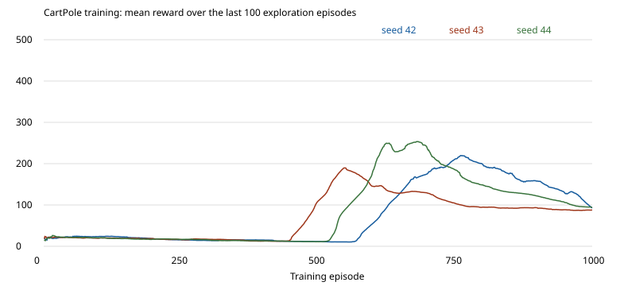

# CartPole development report

These are host simulator results on macOS arm64 with Zig **0.17.0**, ReleaseFast
training, and unchanged integer kernels. They are not physical-control measurements.
Headless improvement was established before adding the GUI. The raw [reports and
curves](experiments/rl-cartpole/) retain all held-out rewards and training metrics.

## Frozen configuration

4→16 ReLU→16 ReLU→2 linear MLP, 386 float parameters. 1,000 training episodes,
SGD 0.005, gamma 0.95, reward scale 1, epsilon 1→0.05 over 10,000 environment steps,
32-sample batches, 10,000-transition replay (480,000 host bytes), warmup 512,
update every step, target copy every 100 SGD updates, TD residual clipping ±1.
The policy with the best 50-episode development mean is retained every 50 episodes.
See [physics and seed partitions](rl.md#cartpole-physics-and-reproducibility).

```sh
zig build --build-file examples/rl-cartpole/build.zig train evaluate e2e firmware \
  -Dseed=42 -Dprogress=plain --prefix /tmp/cartpole-42
zig build --build-file examples/rl-cartpole/build.zig train evaluate \
  -Dseed=43 --prefix /tmp/cartpole-43
zig build --build-file examples/rl-cartpole/build.zig train evaluate \
  -Dseed=44 --prefix /tmp/cartpole-44
```

Final evaluation uses 50 fixed, previously unused environment seeds per policy,
with epsilon 0. Each trained policy and random baseline starts from identical
initial states. Independent training seeds are 42, 43, 44; they share the same
final evaluation seed set. This is a small development comparison, not a population
confidence estimate or a convergence guarantee.

## Reward and action agreement

| Training seed | Random mean | Selected float mean / max | Float successes / 50 | int8 mean / max | int8 successes / 50 | Action agreement |
|---|---:|---:|---:|---:|---:|---:|
| 42 | 18.04 | 217.52 / 384 | 0 | 157.98 / 262 | 0 | 8,053 / 10,876 (74.04%) |
| 43 | 18.04 | 172.26 / 199 | 0 | 169.06 / 191 | 0 | 8,196 / 8,613 (95.16%) |
| 44 | 18.04 | 450.32 / 500 | 41 | 281.92 / 500 | 4 | 18,313 / 22,516 (81.33%) |

A success survives 500 steps without physical failure; all other episodes count
as failures. Reward equals survival steps. Integer/float action agreement is measured
on states encountered by the float policy, with a shared tie rule (LEFT). Integer
reward uses the integer policy's own trajectory. These are different measurements.

| Seed | Best development episode / mean | Final online held-out mean | Final exploration mean100 | Training steps / SGD updates |
|---|---:|---:|---:|---:|
| 42 | 750 / 230.16 | 18.78 | 92.70 | 76,286 / 75,775 |
| 43 | 450 / 174.42 | 98.52 | 87.80 | 72,567 / 72,056 |
| 44 | 600 / 455.38 | 96.40 | 94.64 | 85,822 / 85,311 |



Learning improves over random play, but later online updates regress. Retaining the
best development policy is necessary with this small SGD DQN. The initial 150–200
mean-step goal is reached by selected float policies, not uniformly by every final
online policy. The plotted exploration rewards are not greedy evaluation rewards.

## Quantization audit

Direct PTQ of the absolute Q head produced mean rewards **98.98 / 74.98 / 157.50**
for seeds 42/43/44. A host-only transform subtracts the common final-layer action
component before existing int8 calibration. The original Q checkpoint is untouched;
centered float rollout rewards match the original float rewards for all 50 episodes
of each measured seed. Exported values are centered action scores, not absolute Q.

Calibration uses 2,048 recent training replay states and one normalized cart-boundary
anchor. Held-out evaluation is not used for calibration or policy selection. Centering
improves int8 rewards, but seed 42 loses about 27% and seed 44 about 37% of float
reward. Action margins remain vulnerable to activation rounding. Better calibration,
quantization-aware training or a policy with larger action margins are future work;
the current int8 policy is not presented as float-equivalent.

Generated kernels match **all 128 independent reference score vectors** for seed 42.
That verifies integer arithmetic, not float equivalence or RL quality. Existing
exporter/checkpoint formats and supervised int8/int4 calculations are unchanged.

## Resources and verification

| Item (seed 42) | Bytes / status |
|---|---:|
| Float parameter payload | 1,544 |
| Checkpoint v1 | 1,584 |
| Integer weights + int32 biases | 488 |
| Model workspace | 32 |
| CH32V003 final ELF Flash | 2,040 / 16,320 available (64 reserved) |
| Final static SRAM | 44 / 2,048 |
| Stack allowance | 512 (budget, **not measured**) |
| Remaining SRAM after allowance | 1,492 |
| Hardware cycles / latency / stack high-water | **Not measured** |

The integer-only firmware reads a fixed-size quantized state and exposes action/scores
through volatile symbols. Replay, learning, physics and host UI are excluded. The
final ELF budget includes application/startup/runtime; it rejects a deliberate
1,024-byte Flash limit. No hardware was flashed or physically controlled.

Host tests cover physics, truncation, replay overwrite/sampling, epsilon, Bellman
values, selected-action MSE, target sync, finite validation, policy centering,
checkpoint equality and GUI scheduling/control invariants. The offline pipeline
checks cached/off/reloaded checkpoint and generated-source identity. Root tests,
existing external integration and MLP/CNN int8/int4 fixtures pass. The existing
XOR production firmware remains 1,508 Flash bytes and 16 static SRAM bytes.
Documentation checks resolve 318 local links across 62 files.
See [CI](../.github/workflows/ci.yml) and [test script](../tests/rl_cartpole.sh).

The macOS window was launched and visually checked for automatic training, Pause,
Resume, Watch, Reset and Speed. Controller tests compare identical update prefixes
across pause/watch/rendering and speed schedules. Snapshot output is also checked.
Linux headless and macOS jobs are configured in CI; Linux has not been executed
locally. Long-duration GUI memory profiling, physical hardware timing, actuator
safety and additional training seeds remain unverified.

## Earlier failed configurations

Before freezing the above setup, 600 episodes with gamma 0.99, reward scale 0.1,
updates every four steps and slower epsilon decay reached only ~11 greedy steps.
Extending that setup to 2,000 episodes remained near random or worse. Gamma 0.99
with reward scale 1 and learning rate 0.001 tripped the Q divergence guard. These
experiments motivated the current gamma, update cadence and residual clip; they
are not additional successes and were not tuned against final evaluation seeds.

## Follow-up

The results above remain the original d82c434 baseline. [Control-quality improvements](rl-cartpole-quality.md) use a separately frozen final seed partition and retain all original records. Beginner explanations are available in [English](tutorials/en/05-cartpole-dqn.md) and [日本語](tutorials/ja/05-cartpole-dqn.md).
