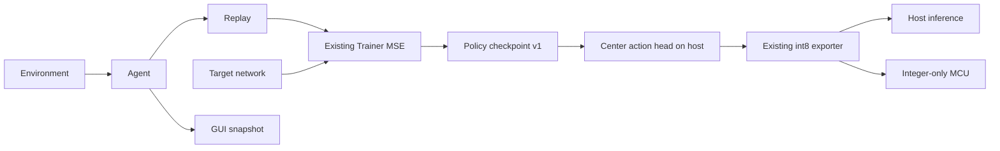

# Host reinforcement learning

Zinn's initial RL support is a small DQN built on the existing float MLP Trainer.
It is additive: `zinn.rl` is host-only; `zinn_infer` imports no replay, environment,
training or GUI code. The exported integer policy uses the existing inference API.
The [CartPole example](../examples/rl-cartpole/README.md) demonstrates the full path.

## Architecture and existing API audit

`Trainer(S).predict`, `trainBatch(..., .mse)`, `encode` and `decode` already support
linear multi-output regression. No changes to the Trainer or checkpoint v1 are
needed. CSV classification labels are not Bellman targets: RL owns its own experience
producer and evaluation. The existing exporter calibrates float activation ranges,
quantizes signed inputs/weights, and provides independent integer reference vectors;
its numerical implementation and existing int8/int4 contracts remain unchanged.



Physics lives only in the example. mimoc-ui consumes snapshots and input; it has
no RL dependency. The desktop uses a bounded single-thread scheduler, avoiding
concurrent mutation of model/workspace. Each caller must own its mutable session
or inference workspace; sharing one without synchronization is unsafe.

## Public host API

Import through `const rl = @import("zinn").rl;`.

| API | Purpose / contract |
|---|---|
| `rl.Random.init(seed)` | Deterministic xorshift32; `unit()`, rejection-sampled `index(bound)` (bound 1…u32 maximum) |
| `rl.Transition(inputs)` | State, action index, reward, next state, terminated/truncated |
| `rl.Replay(inputs).init(storage)` | Borrow a nonempty caller-owned ring slice |
| `Replay.append(item)` | Overwrite oldest when full; does not validate experience |
| `Replay.sample(*Random)` | Deterministic sampling with replacement; `EmptyReplay` on empty |
| `rl.Dqn(S).init(seed, storage, options)` | Online/target Trainers, replay and separate RNG |
| `Dqn.selectAction(*state)` | Epsilon-greedy; first maximum wins ties |
| `Dqn.observe(transition)` | Validate, append, perform scheduled SGD and target sync |
| `Dqn.syncTarget()` | Explicit hard copy of online parameters |
| `rl.dqn.greedy(values)` | Finite-only argmax; rejects empty output |
| `rl.dqn.bellman(reward, terminated, next, gamma)` | Reward-only terminal or reward+gamma×max target Q |
| `rl.dqn.epsilon(options, steps)` | Linear decay, clamped at end |
| `rl.centeredActionHead(S, *Trainer(S))` | Copy policy and center its linear Dense output head |

`S` uses the existing `Definition`. DQN requires a linear output layer. `Options`
contains learning rate, discount, epsilon bounds/steps, batch, warmup, train frequency,
target interval, reward scale, TD clip and Q guard. See [source](../src/rl/dqn.zig)
for exact signatures/defaults and [example options](../examples/rl-cartpole/README.md#configuration).
Storage must hold at least warmup transitions. Batch is 1–128. Invalid rates,
probabilities, nonfinite states/rewards, out-of-range actions and diverged Q values
return errors. Training errors should stop a session; no transactional rollback
of replay/RNG/parameters is promised after failure.

```zig
const S = zinn.Definition(4, &.{
    .{ .units = 16, .activation = .relu },
    .{ .units = 16, .activation = .relu },
    .{ .units = 2 },
});
var storage: [10000]zinn.rl.Transition(4) = undefined;
var agent = try zinn.rl.Dqn(S).init(42, &storage, .{});
// Normalize state, select action, step your environment, then agent.observe(...).
```

Replay borrows storage and allocates nothing itself (48 bytes per transition on
the tested 64-bit host). DQN holds two float Trainers plus a bounded 128-sample
batch on the host stack. The GUI holds replay in its static App, while the headless
tool allocates replay from its process arena. None of this memory is an MCU cost.

## DQN update semantics

The algorithm follows [DQN's replay and target-network approach](https://arxiv.org/abs/1312.5602),
with small SGD updates. The CartPole example is not a benchmark-equivalent reproduction
of that paper. For each sampled transition, freeze current online outputs, replace
only the selected output target, and call existing batch MSE once. Nonselected
output residuals are zero during this update; shared hidden-parameter changes can
still change both outputs on later predictions. No extra forward pass is used by
the progress display.

The selected Bellman residual is clipped to ±1 before constructing a fixed pseudo-target.
Reported loss is this clipped multi-output MSE, not the full Bellman error or a
Huber loss. Target parameters are copied every 100 gradient updates. Physical
termination suppresses bootstrap; time-limit truncation uses the final observation
and bootstraps. If both flags are true, termination takes precedence.

Finite checks and a configurable |Q| guard detect divergence; they cannot guarantee
convergence. Development selection retains a best policy because later SGD updates
can regress. This is policy selection, not full training-session checkpointing.

## CartPole physics and reproducibility

The independent f32 implementation uses the standard equations/constants described
by [Gymnasium's CartPole environment](https://github.com/Farama-Foundation/Gymnasium/blob/main/gymnasium/envs/classic_control/cartpole.py):
g=9.8 m/s², cart mass 1 kg, pole mass 0.1 kg, half-length 0.5 m, force ±10 N,
explicit Euler at 0.02 s. No source code or dependency from Gymnasium is included.
Position beyond ±2.4 m or angle beyond ±12° terminates; 500 steps truncates.
Each step rewards +1, including failure. Reset initializes all four values uniformly
in [-0.05,0.05] using Zinn's own xorshift generator; it does not reproduce Gymnasium's RNG.
Nonfinite states and stepping an already finished episode return errors.

State order is `[x, x_dot, theta, theta_dot]`. Divide by `[2.4, 3, 12*pi/180, 3.5]`
and clamp each component to [-1,1] for training, calibration and float evaluation.
Integer evaluation then uses `export_model.quantizeInput` with the saved input scale.

Training environment seeds occupy the lower 31 bits. Development uses 50 fixed
seeds starting at 0x80000000 every 50 episodes; final evaluation uses 50 unused
seeds starting at 0xc0000000. GUI WATCH uses 0xd0000000 onward. Exploration and replay
share a seeded agent RNG; rendering never consumes it. Repeatability is checked on
the same toolchain/host; bitwise identity of f32 physics/SGD across architectures
is not guaranteed.

## Quantized policy semantics

Absolute DQN Q values often share a large positive component while their action
margin is small. Direct int8 PTQ can erase that difference. `centeredActionHead`
subtracts the mean across output rows of the final weights/bias. All actions lose
the same state-dependent component, so argmax is invariant in real arithmetic.
The returned Trainer is a copy; the original checkpoint and learning targets remain
absolute Q values. Validate floating behavior after transformation because f32
rounding and near-ties can still matter.

The generated **centered action scores are not absolute discounted returns**.
Compare argmax, not raw scores, with the original policy. The existing int8 exporter
is unchanged. Default calibration takes 2,048 recent replay states plus one normalized
cart-boundary anchor to establish input bound 1. These are training data only.
Final evaluation states are never used for calibration or model selection.

Action agreement compares float and int8 on the same states along float rollouts.
Reward evaluation instead lets each policy follow its own trajectory from the same
initial seeds. Exact integer kernel/reference equality does not imply float action
agreement or equal reward. See [measured losses and limitations](rl-cartpole-report.md).

## Control-quality follow-up and beginner tutorials

The [new quality study](rl-cartpole-quality.md) adds an opt-in CartPole-only export path, preserving the original learner and checkpoint. Positive hidden-unit equalization, calibration mean-bias correction and a one-output difference head improve measured int8 control. The shared classification exporter/kernels are unchanged. Begin with [English RL basics](tutorials/en/04-reinforcement-learning.md) or [日本語・強化学習の基本](tutorials/ja/04-reinforcement-learning.md).
