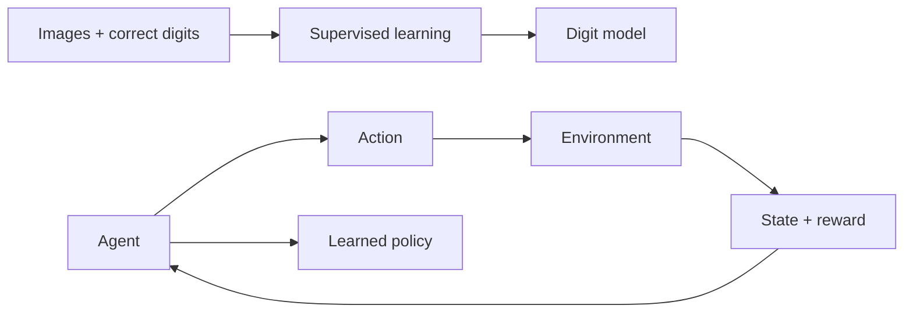

# 0. What is machine learning?

[Next →](01-neural-networks.md) · [日本語](../ja/00-machine-learning-basics.md)

You will learn what a learned model contains, and why training is different from running it.

A conventional program follows rules a developer writes. A digit recognizer might
say “if there is a loop at the top and a line below, choose 9.” Handwriting quickly
makes that rule list difficult to maintain. Machine learning instead adjusts a
collection of numbers using examples. Those numbers become a **model**: a reusable
mapping from input values to output scores. The program still defines the structure,
learning method and data preparation; learning does not invent those automatically.

**Training** changes the model's numbers. **Inference** uses fixed numbers to make
a prediction. Saving a checkpoint merely records numbers already learned; saving
is not another training step. An inference engine is the code that applies the
model, not the model itself.

Zinn demonstrates two ways to learn. In **supervised learning**, MNIST supplies an
image and its correct digit label, such as 7. A trainer compares its scores with
that label. In **reinforcement learning**, CartPole supplies no label saying which
move is correct. An agent tries LEFT/RIGHT and receives a reward for staying alive.
Both use small neural networks, but their targets come from different sources.

A good training result is not proof of good behavior on unfamiliar inputs. Hold
back examples or environment seeds for evaluation. A digit accuracy of 95% means
95 correct predictions out of 100 evaluated images, not a 95% probability that any
particular output is correct. A CartPole reward of 200 means 200 simulation steps
survived, not 200 correct digit predictions.



## In Zinn

[Definitions](../../../src/definition.zig) describe structure;
[Trainer](../../../src/train.zig) changes float parameters. The
[MNIST desktop](../../../examples/mnist-desktop/README.md) runs an already generated
model, while [CartPole](../../../examples/rl-cartpole/README.md) can train and watch
its policy. The test commands below need no board and do not train MNIST.

## Try it

Use Zig 0.17.0 from the repository root. Native UI commands require macOS.

```sh
zig build test
zig build --build-file examples/rl-cartpole/build.zig test
```

## Check your understanding

Training changes numbers; inference applies them. Can you identify where the target comes from in each example?
