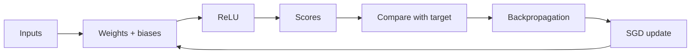
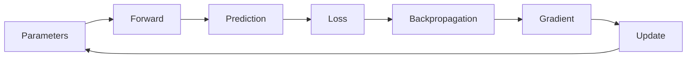

# 1. Neural networks, one small calculation at a time

[← Previous](00-machine-learning-basics.md) · [Next →](02-mnist-training.md) · [日本語](../ja/01-neural-networks.md)

You will learn the parts of a network and how an error can guide a small update.

An **input** is a number describing the example. A **neuron** multiplies each input
by an adjustable **weight**, adds the results, then adds a **bias**, an adjustable
offset. With inputs 2 and 2, weights 0.5 and −0.25, and bias 0.1, the output is
2×0.5 + 2×(−0.25) + 0.1 = **0.6**. Increasing the first weight to 1 changes it to
1.6. That illustrates what changing a parameter does; it does not mean increasing
weights always improves predictions.

A **layer** groups neurons that process the same input. Several layers can build
more useful combinations. **ReLU** (rectified linear unit) keeps a positive number
and replaces a negative one with zero: −3 becomes 0; 2 stays 2. Without such
nonlinear operations, a stack of linear layers could collapse into one linear map.
The last layer produces scores. The task defines what those scores mean.

A **loss** is a number measuring a mismatch with a target. For one output, mean
squared error (MSE) squares the difference: predicting 0.6 for target 1 gives 0.16.
A **gradient** tells how the loss changes when each parameter changes a little.
**Backpropagation** calculates those directions from output back to earlier layers.
It is bookkeeping through the calculation, not a search over every possible weight.

**SGD**, stochastic gradient descent, nudges parameters in the opposite direction
to the gradient. A **learning rate** controls the size of that nudge. A **batch** is
a group of examples used for one update; an **epoch** is one pass through a dataset.
Zinn's low-level `Trainer.epochs` counter counts batch updates, not dataset passes;
the higher-level fitting loop tracks actual epochs. A smaller training loss after
one update says nothing by itself about held-out accuracy.





## In Zinn

[Definition](../../../src/definition.zig) fixes layer sizes.
[Trainer](../../../src/train.zig) provides `forward()` for intermediate values,
`gradientWithLoss()` for loss/gradients, and `trainBatch()` for an SGD update.
The complete [numerical example](../../../examples/docs/learning.zig) compiles and
runs as part of `zig build docs-check`; it checks the 0.6 output and decreasing MSE.
A second test checks integer rounding and a Bellman target.

## Try it

Use Zig 0.17.0 from the repository root. Native UI commands require macOS.

```sh
zig build docs-check
```

## Check your understanding

Weights control influence, bias shifts a result, and gradients guide small updates. Why is “make every weight larger” not a learning algorithm?

<!-- zinn-learning-sample -->
```zig
//! Executable numerical examples used by the bilingual introductory tutorials.
const std = @import("std");
const z = @import("zinn");
test "one neuron: forward, gradient and SGD" {
    const S = z.Definition(2, &.{.{ .units = 1 }});
    const T = z.Trainer(S);
    var model = T.init(42);
    model.parameters = .{ 0.5, -0.25, 0.1 };
    const sample: T.Sample = .{ .input = .{ 2, 2 }, .target = .{1} };
    var activations: T.Activations = undefined;
    model.forward(&sample.input, &activations);
    try std.testing.expectApproxEqAbs(@as(f32, 0.6), activations[1][0], 0.00001);
    var gradient: [S.parameter_count]f32 = undefined;
    const before = model.gradientWithLoss(sample, &gradient, .mse);
    try std.testing.expect(gradient[0] < 0);
    _ = try model.trainBatch(&.{sample}, 0.01, .mse);
    const after = model.gradientWithLoss(sample, &gradient, .mse);
    try std.testing.expect(after < before);
}
test "quantization rounding and terminal Bellman target" {
    try std.testing.expectEqual(@as(i8, 3), try z.export_model.quantizeInput(0.26, 0.1));
    try std.testing.expectEqual(@as(i8, 127), try z.export_model.quantizeInput(100, 0.1));
    try std.testing.expectEqual(@as(i8, -128), try z.export_model.quantizeInput(-100, 0.1));
    try std.testing.expectApproxEqAbs(@as(f32, 4.8), try z.rl.dqn.bellman(1, false, &.{ 2, 4 }, 0.95), 0.00001);
    try std.testing.expectEqual(@as(f32, 1), try z.rl.dqn.bellman(1, true, &.{ 2, 4 }, 0.95));
}
```
