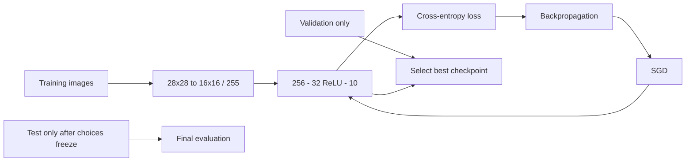

# 2. How MNIST training works

[← Previous](01-neural-networks.md) · [Next →](03-mnist-inference.md) · [日本語](../ja/02-mnist-training.md)

You will learn how labeled images become a model and why three data splits matter.

MNIST contains grayscale pictures of handwritten digits 0–9. A **label** gives the
correct digit. Zinn reads IDX (a compact array file format), including gzip-compressed
files, and area-resizes each 28×28 image to 16×16. Dividing brightness by 255 turns
pixels into values near 0–1. There are 256 inputs. The model discussed here uses
32 ReLU neurons and 10 linear output scores. The CLI default hidden width is **16**;
request 32 explicitly to match this chapter and the bundled desktop model.

For an image labeled 7, the network first computes all ten scores. **Cross-entropy**
is a training loss that rewards putting more relative weight on the correct class.
Inside float training, softmax converts scores into positive class weights summing
to one, and a logarithm measures the correct-class weight. Stable evaluation avoids
large exponentials. This does not make the raw output scores (logits) probabilities. Backpropagation finds gradients, SGD updates
the weights, and mini-batches repeat this process over many images.

The **training set** supplies updates. A **validation set** is held aside to compare
checkpoints and settings without changing weights from those examples. The **test
set** is reserved for a final evaluation after choices are fixed. Looking repeatedly
at test results while adjusting the model turns the test set into another validation
set and makes the final score less informative.

The documented real-data MLP32 recipe uses 60,000 official training images split
into 55,000 fitting and 5,000 validation images (split seed 24301); seed 42 controls
initialization/order. Batch size is 32. The recipe requests rate 0.1 and 20 epochs;
default rate is 0.05. Rate decays ×0.3 every 10 epochs. Best validation accuracy
selects the saved checkpoint, with cross-entropy as the tie-breaker. The official
10,000 test images are only read when test evaluation is explicitly selected.

The command below uses tiny synthetic fixtures and one epoch to verify the pipeline
quickly. **Its accuracy is not MNIST accuracy.** For real fitting, follow the linked
MNIST tutorial rather than interpreting fixture scores as recognition quality.



## In Zinn

The [MNIST tutorial](../mnist.md) provides real-data commands and provenance.
[Data loading](../../../src/data.zig), [fit](../../../src/fit.zig),
[MNIST tools](../../../tools) and [Build options](../../api/build.md) implement the
pipeline. [Trainer checkpoints](../../../src/train.zig) store float parameters,
seed, schema and checksum in v1; preprocessing and dataset split settings must be
kept with the report, because a checkpoint alone does not describe them.

<!-- zinn-mnist-definition -->
```zig
const z = @import("zinn");
pub const Structure = z.Definition(256, &.{ .{ .units = 32, .activation = .relu }, .{ .units = 10 } });
```

## Try it

Use Zig 0.17.0 from the repository root. Native UI commands require macOS.

```sh
zig build train evaluate -Dproject=mnist -Dmnist-fixture=true -Dmnist-hidden=32 -Dmnist-epochs=1 -Dapp-name=learning-mnist
```

## Check your understanding

Validation chooses a checkpoint; test reports final performance. Why should the test images never supply gradients or calibration data?
