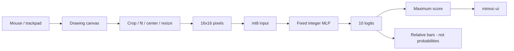

# 3. What happens when you draw a digit?

[← Previous](02-mnist-training.md) · [Next →](04-reinforcement-learning.md) · [日本語](../ja/03-mnist-inference.md)

You will follow a handwritten stroke through the integer model to the screen.

The desktop canvas stores grayscale ink. Mouse or trackpad movements add strokes;
CLEAR removes them. Zinn crops the ink, fits it inside a 20×20 area of a 28×28
frame, centers its mass, then area-resizes to 16×16. Blank input clears the result.
This preparation makes user drawings resemble the training images; it cannot
promise identical behavior for every writing style.

Each of the 256 pixels is a brightness value near 0–1. The generated model's input
scale converts those values to signed int8 numbers with rounding and saturation.
Reducing 28×28 to 16×16 lowers input storage and the number of first-layer weights;
it also discards detail. It is a size/accuracy trade-off, not a universal best size.

A Dense layer performs **multiply-accumulate**: multiply each input by its stored
weight, add the products and a bias into an int32 accumulator. Requantization turns
that accumulator into an int8 activation, a temporary layer result, for the next layer. ReLU clips values below
the encoded zero to zero. The last layer produces ten signed scores, one per digit.
**Argmax** chooses the index of the largest score; Zinn chooses the first maximum
on a tie.

Those final scores are **logits**, relative model outputs. They may be negative.
They do not sum to 1 or 100, so they are not probabilities. The desktop's bars use
the current ten scores' minimum and maximum: the minimum gets an empty bar and
the maximum gets a full bar. If all are equal, all bars are empty. This display
emphasizes relative ranking; bar length is neither recognition probability nor
measured confidence. A small change in one class can rescale all bars. For example, if the ten scores span −10 to 10, score 0 receives a half-width bar, not a 50% probability.

Inference never updates weights. The drawing changes input activations and output
scores only. Otherwise each new drawing could erase what the model learned, and
there would be no correct label available to guide that change.



## In Zinn

[Canvas preparation](../../../examples/mnist-desktop/canvas.zig),
[application inference](../../../examples/mnist-desktop/app.zig) and
[bar scaling](../../../examples/mnist-desktop/logits.zig) are separate pieces.
[Dense kernels](../../../src/kernels) and [Sequential](../../../src/model.zig)
perform fixed integer inference. The example bundles an MLP32 model, so launching
needs neither model training nor MNIST download. Native UI currently requires macOS;
the headless tests also run on Linux.

## Try it

Use Zig 0.17.0 from the repository root. Native UI commands require macOS.

```sh
zig build --build-file examples/mnist-desktop/build.zig test
# macOS
zig build --build-file examples/mnist-desktop/build.zig run -Doptimize=safe
```

## Check your understanding

What changes when you draw: weights or activations? Why can a full bar still belong to an incorrect prediction?
