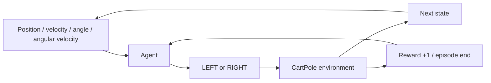

# 4. Reinforcement learning: learning from consequences

[← Previous](03-mnist-inference.md) · [Next →](05-cartpole-dqn.md) · [日本語](../ja/04-reinforcement-learning.md)

You will learn the vocabulary of trial-and-feedback learning without assuming a
correct action label exists.

An **environment** is the world being controlled, here a CartPole simulator. Its
**state** describes cart position, cart velocity, pole angle and pole angular
velocity. An **agent** chooses an **action**, LEFT or RIGHT. The simulator applies
a force and returns a new state and a **reward**. A complete attempt is an **episode**.
It ends when the pole falls, the cart leaves the track, or the 500-step limit is met.

A **policy** is the rule the agent uses to choose an action from a state. In Zinn's
example, a neural network estimates two action values and the policy picks the
larger. That is different from MNIST's correct digit label: nobody tells the agent
“LEFT was the correct answer” for each state.

CartPole rewards +1 for every simulated step, including its final failure step.
That immediate reward looks the same for LEFT and RIGHT. Learning becomes possible
because actions affect how long future rewards continue. An action's **value** is
an estimate of future reward, not the current reward and not a probability of success.
For example, receiving +1 now while making a fall unavoidable can be worse than
receiving +1 now while keeping the pole balanced.

**Exploration** tries actions that may not currently look best, to gather information.
**Exploitation** uses the best action currently known. Epsilon-greedy mixes them:
with probability epsilon, choose a random action; otherwise choose the largest Q
value. At epsilon 1 all actions are exploratory; at 0 evaluation is greedy. Training
reward with exploration and evaluation reward without it are different measurements.

A reward of 200 means 200 steps at 0.02 simulated seconds each: 4 simulated seconds.
It does not mean the application spent 4 wall-clock seconds computing. Headless
training can advance the simulation much faster than a real-time animation.



## In Zinn

The [environment](../../../examples/rl-cartpole/environment.zig) owns physics and
reward, the [agent session](../../../examples/rl-cartpole/agent.zig) owns episodes,
and [DQN](../../../src/rl/dqn.zig) owns learning. No environment code is included in
the MCU policy. The command below learns without a GUI and then shows saved evaluation
results; a Build cache hit reuses artifacts and does not mean another training run.

## Try it

Use Zig 0.17.0 from the repository root. Native UI commands require macOS.

```sh
zig build --build-file examples/rl-cartpole/build.zig train evaluate -Dprogress=plain
```

## Check your understanding

What does the environment provide instead of a correct action label? Why should greedy evaluation be separated from exploratory training reward?
