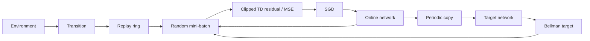

# 5. How Zinn trains CartPole with DQN

[← Previous](04-reinforcement-learning.md) · [Next →](06-quantization-and-mcu.md) · [日本語](../ja/05-cartpole-dqn.md)

You will connect experience, future-value targets and SGD to the actual code.

DQN means **Deep Q-Network**: a neural network estimates the value Q of each action.
This example has four normalized state inputs, two hidden layers of 16 ReLU units,
and two linear outputs, LEFT and RIGHT Q. It has 386 trainable parameters. The
state divisors are 2.4, 3, 12*pi/180 and 3.5, followed by clamping to [-1,1].

At each step the agent chooses an epsilon-greedy action, advances physics, and stores
a **transition**: state, action, reward, next state and end flags. A **replay buffer**
is a ring of recent transitions. Sampling old experiences breaks up strongly
correlated consecutive steps and reuses costly observations. It does not create
new independent real-world experiences.

The **online network** is updated by SGD. A **target network** is a periodically
copied version used to build more slowly changing learning targets. Without that
separation, both the prediction and its target would move at every update. Replay
and a target network improve stability but do not guarantee convergence.

The Bellman target means: “include the reward just received, then add a discounted
estimate of the best reward still available from the next state.” A **discount
factor** gamma reduces the contribution of distant rewards. With reward 1, next-state
values 2 and 4, and gamma 0.95, the target is 1 + 0.95×4 = **4.8**.

Only after that intuition, the formula is `target = reward + gamma * max(Q_target(next))`.
Physical failure has no future and uses target=reward. A time-limit truncation uses
the final observation and still bootstraps (adds estimated future value). The
**temporal-difference (TD) residual** is target minus the online prediction.

Zinn clips the selected action's TD residual to ±1, constructs a pseudo-target,
and uses the unchanged MSE Trainer. Nonselected output residuals are zero for that
batch, although shared hidden-weight updates can change both future outputs. This
is clipped-target MSE, not a separately implemented Huber loss or Double DQN.
Defaults are SGD 0.005, gamma 0.95, batch 32, replay 10,000, warmup 512, epsilon
1→0.05 over 10,000 steps and target synchronization every 100 SGD updates.

Late learning can regress: exploration, a changing replay distribution and moving
value targets interact. Zinn retains the best policy on separate development episodes;
the last online parameters need not be best. A tested rate decay did not stabilize
all seeds, so production defaults remain unchanged. A checkpoint stores the policy,
not replay/RNG/target-network state, and loading is not full session resumption.



## In Zinn

[DQN](../../../src/rl/dqn.zig), [replay](../../../src/rl/replay.zig),
[episode selection](../../../examples/rl-cartpole/agent.zig) and
[quality report](../../rl-cartpole-quality.md) show the implementation and limitations.
The command below trains the original two-output Q network but exports the improved
one-output integer action margin. It does not change DQN to a single-output learner.
`e2e` checks integer reference equality; it is not an episode success rate.

<!-- zinn-cartpole-definition -->
```zig
const z = @import("zinn");
pub const Structure = z.Definition(4, &.{ .{ .units = 16, .activation = .relu }, .{ .units = 16, .activation = .relu }, .{ .units = 2 } });
```

## Try it

Use Zig 0.17.0 from the repository root. Native UI commands require macOS.

```sh
zig build --build-file examples/rl-cartpole/build.zig train evaluate e2e -Dpolicy-export=improved -Dprogress=plain
```

## Check your understanding

Why does the terminal target omit future value? Why can the best saved checkpoint outperform the last online network?
