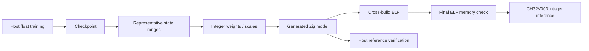

# 6. Quantization and a very small microcontroller

[← Previous](05-cartpole-dqn.md) · [日本語](../ja/06-quantization-and-mcu.md)

You will learn what changes when a float model becomes integer firmware.

**Float32** stores approximate real numbers using 32 bits. **int8** stores integers
from −128 to 127 using 8 bits. A **scale** connects integer and real units. With
scale 0.1, 0.26 rounds to integer 3, representing about 0.3; the error is 0.04.
Values beyond the representable range are **saturated**, meaning clamped to an end
value. Rounding adds small errors even when no saturation occurs.

A **weight** is a learned multiplier, a **bias** a learned offset, and an **activation**
a temporary result for the current input. Zinn stores int8 weights and uses an
**int32 accumulator**, a wider integer sum, so many products can be added safely. Zinn checks worst-case accumulator bounds; a wider type alone is not a guarantee for arbitrary model sizes.
Its existing requantization uses an int64 product, integer rounding and saturation;
it does not use floating-point arithmetic in MCU inference. **Workspace** is explicit
scratch memory reused between layers, not a second copy of the model weights.

**Calibration** runs representative inputs on the host to estimate useful numerical
ranges. Post-training quantization (PTQ) then converts parameters and scales.
A **checkpoint** holds a reusable float training model. A **generated model** is Zig
source containing integer parameters and a static inference definition. The inference
engine supplies operations; it does not learn from the generated file.

For MNIST, small score errors matter when the leading digits are close. In CartPole,
small errors can reverse the sign of RIGHT−LEFT. One different action changes the
next state, so trajectories can diverge and amplify an initially small difference.
Same-state action agreement therefore differs from reward on independent trajectories.

The improved CartPole export preserves the original Q checkpoint. On the host it
balances positive ReLU ranges, corrects calibration mean bias error and exports a
single RIGHT−LEFT score with a finer output scale. Positive means RIGHT; zero or
negative means LEFT. These scores are not absolute Q returns or probabilities.
Real-arithmetic transformations can still differ near ties in float32; measured
results and exceptions are reported, not assumed away.

CH32V003 offers 16 KB Flash and 2 KB SRAM. Learning stays on the host. Flash holds immutable weights and program code; SRAM holds inputs, outputs, workspace and stack. The MCU stores
only generated weights, integer code, application buffers and workspace. The final
ELF includes startup/runtime/application costs; checking parameter bytes alone is
insufficient. A stack allowance reserves space but is not a measured stack high-water.
The CartPole firmware is a minimal fixed-vector policy example: it contains no game,
physics, replay or learning, and is not a physical cart controller.

The frozen new final seed set in the command below is a reproducibility evaluation,
not data to tune another candidate against. `firmware` builds and checks capacity;
it does not write hardware. Physical latency and stack high-water remain unmeasured.



## In Zinn

[Exporter](../../../src/export.zig), [integer rounding](../../../src/quant.zig),
[kernels](../../../src/kernels), [workspace](../../../src/workspace.zig),
[CartPole host export](../../../examples/rl-cartpole/policy_export.zig) and
[firmware](../../../examples/rl-cartpole/firmware.zig) separate responsibilities.
The [quality report](../../rl-cartpole-quality.md) compares mean/median reward,
success, action agreement and final ELF size without changing old baseline records.

## Try it

Use Zig 0.17.0 from the repository root. Native UI commands require macOS.

```sh
zig build --build-file examples/rl-cartpole/build.zig firmware -Dpolicy-export=improved
zig build --build-file examples/rl-cartpole/build.zig study -Dfinal-test=true -Dprogress=off
```

## Check your understanding

Where do weights, activations and workspace live? Why does exact integer-reference agreement not prove equal float control quality?
