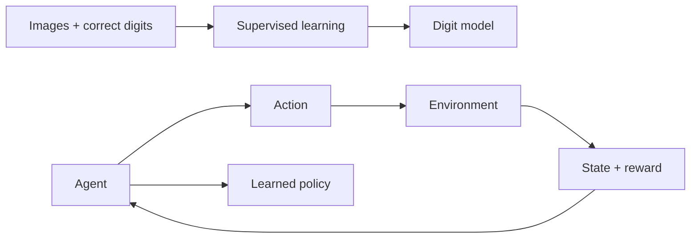

# 0. 機械学習とは何か

[次の章 →](01-neural-networks.md) · [English](../en/00-machine-learning-basics.md)

この章では、学習済みモデルに何が入っているのか、学習と推論がどう違うのかを学びます。

普通のプログラムは、人が書いた規則に従います。数字認識なら「上に輪があり、下に線があれば9」と書けるかもしれません。しかし筆跡が変わるたびに規則を足すのは大変です。機械学習では、例を使ってたくさんの数値を調整します。その数値の集まりが**モデル**です。入力を出力スコアへ変換するために再利用できます。構造、学習方法、データの準備は依然としてプログラムで決めます。学習がすべてを自動で発明するわけではありません。

**学習**はモデルの数値を変更する処理です。**推論**は、固定した数値を使って予測する処理です。Checkpointへの保存は、すでに学んだ数値を記録するだけで、追加の学習ではありません。推論エンジンはモデルの計算を実行するコードであり、学習済みの数値そのものとは別です。

Zinnには2種類の学び方があります。**教師あり学習**のMNISTでは、画像と「正解は7」のようなラベルを与えます。Trainerはその正解と出力を比較します。**強化学習**のCartPoleでは、正しい操作のラベルは与えません。AIが左右への移動を試し、棒を維持できた長さに応じて報酬を受け取ります。どちらも小さなニューラルネットワークを使いますが、学習目標の出所が違います。

学習に使った例で良い結果が出ても、未知の入力に強いとは限りません。評価用の画像や環境seedを分けます。分類精度95%は、評価した100枚中95枚を正しく分類したという意味で、個々の予測が95%の確率で正しいという意味ではありません。CartPoleのReward 200は200ステップ生存したという意味で、数字を200回正解したという意味ではありません。



## Zinnでの実装

[Definition](../../../src/definition.zig)が構造を決め、[Trainer](../../../src/train.zig)がfloatのパラメータを更新します。[MNIST Desktop](../../../examples/mnist-desktop/README.md)は生成済みモデルを動かし、[CartPole](../../../examples/rl-cartpole/README.md)は学習とPolicyの観察に対応します。次のテストは基板不要で、MNISTの学習も実行しません。

## 試してみる

Zig 0.17.0を使い、リポジトリのルートから実行します。GUIコマンドはmacOS用です。

```sh
zig build test
zig build --build-file examples/rl-cartpole/build.zig test
```

## 理解を確かめる

学習は数値を変更し、推論は数値を使います。MNISTとCartPoleでは、それぞれ何を根拠に学習目標を作るのでしょうか。
