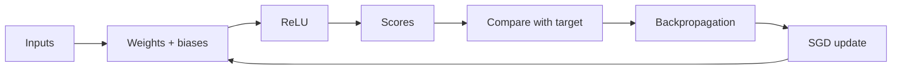
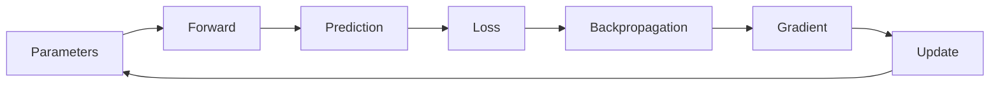

# 1. 小さな計算から理解するニューラルネットワーク

[← 前の章](00-machine-learning-basics.md) · [次の章 →](02-mnist-training.md) · [English](../en/01-neural-networks.md)

この章では、ネットワークの部品と、誤差を使った小さな更新を学びます。

**入力**は例を表す数値です。**ニューロン**は入力ごとに**重み**という調整可能な倍率を掛け、足し合わせて、**バイアス**という調整可能な定数を加えます。入力が2と2、重みが0.5と−0.25、バイアスが0.1なら、出力は2×0.5＋2×(−0.25)＋0.1＝**0.6**です。最初の重みを1へ変えると1.6になります。重みを変えると結果が変わる例であり、大きくすれば常に正解へ近づくという意味ではありません。

**Layer（層）**は同じ入力を処理するニューロンの集まりです。層を重ねると入力の組み合わせを扱えます。**ReLU（整流線形関数）**は正の値を残し、負の値を0へ置き換えます。−3は0、2は2になります。このような非線形の処理がなければ、線形な層を重ねても1つの線形変換にまとめられます。最終層はスコアを出し、その意味は用途によって変わります。

**Loss（損失）**は、予測と学習目標のずれを数値化したものです。1出力の**MSE（平均二乗誤差）**なら、目標1に対して予測0.6の誤差は(0.6−1)²＝0.16です。**Gradient（勾配）**は、それぞれのパラメータを少し変えると損失がどちらへ動くかを表します。**Backpropagation（誤差逆伝播）**は、出力側から入力側へ計算をたどって、その方向を求めます。あらゆる重みの組み合わせを総当たりする方法ではありません。

**SGD（確率的勾配降下法）**は、勾配と反対の方向へパラメータを少し動かします。**学習率**がその一歩の大きさです。**Batch（バッチ）**は1回の更新で使う例の集まり、**Epoch（エポック）**はデータセットを一通り処理する単位です。ただしZinnの低レベル`Trainer.epochs`はバッチ更新回数を数えます。実際のEpochは上位のfit処理が管理します。1回の更新で損失が減っただけでは、未知のデータでの精度までは分かりません。





## Zinnでの実装

[Definition](../../../src/definition.zig)で層の大きさを固定します。[Trainer](../../../src/train.zig)の`forward()`は中間値、`gradientWithLoss()`は損失と勾配を計算し、`trainBatch()`がSGDの更新を行います。[実行可能な数値例](../../../examples/docs/learning.zig)は`zig build docs-check`でコンパイル・実行され、出力0.6とMSEの減少を検証します。もう1つのテストは整数の丸めとBellman targetを確認します。

## 試してみる

Zig 0.17.0を使い、リポジトリのルートから実行します。GUIコマンドはmacOS用です。

```sh
zig build docs-check
```

## 理解を確かめる

重みは入力の影響、バイアスはずれ、勾配は更新の方向を表します。「すべての重みを大きくする」だけではなぜ学習にならないのでしょうか。

<!-- zinn-learning-sample -->
```zig
//! Executable numerical examples used by the bilingual introductory tutorials.
const std = @import("std");
const z = @import("zinn");
test "one neuron: forward, gradient and SGD" {
    const S = z.Definition(2, &.{.{ .units = 1 }});
    const T = z.Trainer(S);
    var model = T.init(42);
    model.parameters = .{ 0.5, -0.25, 0.1 };
    const sample: T.Sample = .{ .input = .{ 2, 2 }, .target = .{1} };
    var activations: T.Activations = undefined;
    model.forward(&sample.input, &activations);
    try std.testing.expectApproxEqAbs(@as(f32, 0.6), activations[1][0], 0.00001);
    var gradient: [S.parameter_count]f32 = undefined;
    const before = model.gradientWithLoss(sample, &gradient, .mse);
    try std.testing.expect(gradient[0] < 0);
    _ = try model.trainBatch(&.{sample}, 0.01, .mse);
    const after = model.gradientWithLoss(sample, &gradient, .mse);
    try std.testing.expect(after < before);
}
test "quantization rounding and terminal Bellman target" {
    try std.testing.expectEqual(@as(i8, 3), try z.export_model.quantizeInput(0.26, 0.1));
    try std.testing.expectEqual(@as(i8, 127), try z.export_model.quantizeInput(100, 0.1));
    try std.testing.expectEqual(@as(i8, -128), try z.export_model.quantizeInput(-100, 0.1));
    try std.testing.expectApproxEqAbs(@as(f32, 4.8), try z.rl.dqn.bellman(1, false, &.{ 2, 4 }, 0.95), 0.00001);
    try std.testing.expectEqual(@as(f32, 1), try z.rl.dqn.bellman(1, true, &.{ 2, 4 }, 0.95));
}
```
