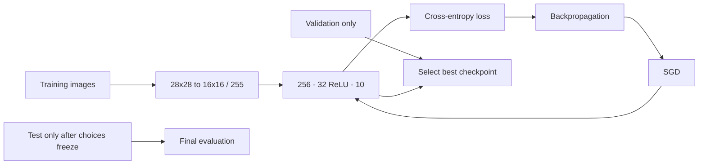

# 2. MNISTはどう学習するのか

[← 前の章](01-neural-networks.md) · [次の章 →](03-mnist-inference.md) · [English](../en/02-mnist-training.md)

この章では、正解付き画像からモデルを作る流れと、3種類のデータの役割を学びます。

MNISTは0〜9の手書き数字をグレースケール画像で集めたデータセットです。**ラベル**が正解の数字を示します。Zinnは配列用のファイル形式IDXを読み、gzip圧縮にも対応します。28×28画像を面積に基づく平均で16×16へ縮小し、明るさを255で割って、およそ0〜1の値にします。入力は256個です。この章のモデルはReLUニューロン32個と、線形の出力スコア10個を持ちます。CLIの隠れ層幅の既定値は**16**なので、32を明示してDesktopの同梱モデルと揃えます。

正解7の画像なら、まずネットワークが10個のスコアを計算します。**Cross-Entropy（交差エントロピー）**は、正解クラスの相対的な重みが増えるように学習を導く損失です。floatの学習内部では、softmax（スコアを正の値へ変換し、合計1にする処理）と対数を使い、正解クラスへの重みを測ります。大きな指数の値を避けるよう数値を安定させます。ただし、生の出力スコア（Logit）がそのまま確率になるわけではありません。誤差逆伝播で勾配を求め、SGDで重みを更新し、多くの画像をバッチで繰り返し処理します。

**Training Dataset（学習データ）**は重みの更新に使います。**Validation Dataset（検証データ）**は重みを更新せず、Checkpointや設定の比較に使います。**Test Dataset（テストデータ）**は設定を固定した後の最終評価用です。テスト結果を何度も見て調整すると、テストも事実上の検証データになり、最終精度の意味が弱くなります。

実データのMLP32手順では、公式の学習画像60,000枚を55,000枚の学習用と5,000枚の検証用に分けます。分割seedは24301、初期化と順序のseedは42です。バッチ32、手順中の学習率は0.1、20 Epochです。学習率の既定値は0.05で、10 Epochごとに0.3倍になります。最良の検証精度でCheckpointを選び、同精度なら交差エントロピーで比較します。公式テスト10,000枚は、テスト評価を明示した場合だけ読み込みます。

下のコマンドは小さな合成Fixtureと1 Epochで経路を確認するものです。**この精度をMNISTの認識精度と解釈してはいけません。** 実データでの学習はリンク先のMNISTチュートリアルを参照してください。



## Zinnでの実装

[MNIST手順](../mnist.md)に実データ用コマンドがあります。[データ読込](../../../src/data.zig)、[fit](../../../src/fit.zig)、[MNISTツール](../../../tools)、[Build API](../../api/build.md)が経路を構成します。[Checkpoint v1](../../../src/train.zig)にはfloatパラメータ、seed、構造の識別子、チェックサムを保存します。前処理やデータ分割の設定はCheckpointだけでは分からないため、レポートと一緒に保管します。

<!-- zinn-mnist-definition -->
```zig
const z = @import("zinn");
pub const Structure = z.Definition(256, &.{ .{ .units = 32, .activation = .relu }, .{ .units = 10 } });
```

## 試してみる

Zig 0.17.0を使い、リポジトリのルートから実行します。GUIコマンドはmacOS用です。

```sh
zig build train evaluate -Dproject=mnist -Dmnist-fixture=true -Dmnist-hidden=32 -Dmnist-epochs=1 -Dapp-name=learning-mnist
```

## 理解を確かめる

検証データでCheckpointを選び、テストデータで最終性能を測ります。なぜテスト画像を勾配計算やCalibrationへ使ってはいけないのでしょうか。
