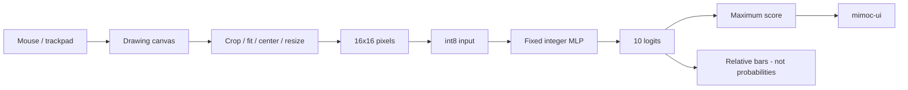

# 3. 数字を書くと推論はどう動くのか

[← 前の章](02-mnist-training.md) · [次の章 →](04-reinforcement-learning.md) · [English](../en/03-mnist-inference.md)

この章では、手書きの線が整数モデルを通り、画面に結果が出るまでを追います。

Desktopのキャンバスは濃淡のあるインクを保存します。マウスやトラックパッドで線を加え、CLEARで消します。Zinnはインクの範囲を切り出し、28×28の枠の中の20×20領域へ収め、重心を中央へ寄せて、16×16へ面積平均で縮小します。空白なら結果をリセットします。学習画像に近い入力へ整える処理ですが、すべての筆跡で同じ結果を保証するものではありません。

256画素は、およそ0〜1の明るさです。生成モデルの入力スケールで割り、丸めと飽和処理によって符号付きint8へ変換します。28×28から16×16へ縮めると、入力の保存領域と最初の層の重みを減らせます。その代わり細部を失います。容量と精度の選択であり、常に16×16が最適という意味ではありません。

Dense層では**積和演算**を行います。入力と保存された重みを掛け、積とバイアスをint32の累積値へ足します。再量子化によって次の層へ渡す一時的な値（Activation）をint8へ変換し、ReLUで符号化されたゼロ未満をゼロへ置き換えます。最後に数字ごとの10個のスコアが出ます。**Argmax**は最大スコアの位置を選ぶ処理です。Zinnでは同点なら先にあるクラスを選びます。

最後のスコアは**Logit**と呼ぶ相対的なモデル出力です。負でも構いません。合計が1や100になる値ではないため、確率ではありません。Desktopの棒は、その時の10クラスの最小値を空、最大値を最大幅にして表示します。全クラス同点なら空の棒になります。順位と差を見やすくする表示であり、棒の長さは認識確率でも測定された信頼度でもありません。1クラスの変化によって全バーの縮尺が変わることもあります。たとえば10スコアの範囲が−10〜10なら、スコア0の棒は半分の幅になりますが、確率50%という意味ではありません。

推論では重みを変更しません。絵によって変わるのは入力、Activation、出力スコアです。描くたびに重みを書き換えると学習内容が失われかねず、更新を導く正解ラベルもその場では与えられていません。



## Zinnでの実装

[キャンバス前処理](../../../examples/mnist-desktop/canvas.zig)、[アプリの推論](../../../examples/mnist-desktop/app.zig)、[バー表示](../../../examples/mnist-desktop/logits.zig)は分離されています。[Denseカーネル](../../../src/kernels)と[Sequential](../../../src/model.zig)が整数推論を実行します。MLP32モデルは同梱済みなので、起動時の学習やMNIST取得は不要です。GUIは現在macOS用で、HeadlessテストはLinuxでも実行できます。

## 試してみる

Zig 0.17.0を使い、リポジトリのルートから実行します。GUIコマンドはmacOS用です。

```sh
zig build --build-file examples/mnist-desktop/build.zig test
# macOS
zig build --build-file examples/mnist-desktop/build.zig run -Doptimize=safe
```

## 理解を確かめる

絵を描いたとき、変わるのは重みとActivationのどちらでしょうか。最大幅のバーでも予測が間違うのはなぜでしょうか。
