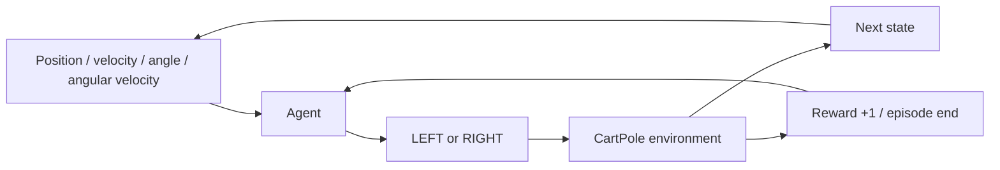

# 4. 強化学習：行動の結果から学ぶ

[← 前の章](03-mnist-inference.md) · [次の章 →](05-cartpole-dqn.md) · [English](../en/04-reinforcement-learning.md)

この章では、正しい行動のラベルがない学習の基本用語を理解します。

**Environment（環境）**は操作する世界で、ここではCartPoleシミュレータです。**State（状態）**は台車の位置と速度、棒の角度と角速度です。**Agent（エージェント）**が**Action（行動）**としてLEFTかRIGHTを選びます。環境は力を加えて、新しい状態と**Reward（報酬）**を返します。1回の試行が**Episode（エピソード）**です。棒が倒れる、台車が範囲を外れる、500ステップへ達する、のいずれかで終了します。

**Policy（方策）**は状態から行動を選ぶ規則です。Zinnの例では、ネットワークが2つの行動価値を推定し、大きい方を選びます。MNISTの正解ラベルとは違い、状態ごとに「LEFTが正解だった」とは教えません。

CartPoleは、失敗する最後のステップを含め、毎ステップ+1を返します。この直後の報酬は左右どちらでも同じです。それでも学べるのは、行動によって将来も報酬を受け取れる長さが変わるためです。行動の**価値**は将来の報酬の推定であって、今の報酬そのものでも、成功確率でもありません。今+1を得ても転倒を避けられなくする行動は、今+1を得ながら棒を維持する行動より悪いかもしれません。

**Exploration（探索）**は、今は良さそうに見えない行動も試して経験を集めることです。**Exploitation（活用）**は、現在分かっている最良の行動を使うことです。ε-greedyは、確率εでランダムな行動を選び、それ以外では最大Q値を選びます。ε=1ならすべて探索、ε=0なら評価時のGreedy動作です。探索を含む学習Rewardと、探索を止めた評価Rewardは分けます。

Reward 200は、0.02秒の物理ステップを200回、つまりシミュレーション上4秒間生存したことを表します。計算に実時間で4秒かかったという意味ではありません。GUIなしの学習は、実時間より速く環境を進められます。



## Zinnでの実装

[Environment](../../../examples/rl-cartpole/environment.zig)が物理と報酬、[Session](../../../examples/rl-cartpole/agent.zig)がEpisode、[DQN](../../../src/rl/dqn.zig)が学習を担当します。MCUのPolicyに環境コードは含まれません。次のコマンドはGUIなしで学習し、保存された評価を表示します。Buildキャッシュのヒットは成果物の再利用であり、新たな学習ではありません。

## 試してみる

Zig 0.17.0を使い、リポジトリのルートから実行します。GUIコマンドはmacOS用です。

```sh
zig build --build-file examples/rl-cartpole/build.zig train evaluate -Dprogress=plain
```

## 理解を確かめる

環境は正解の行動ラベルの代わりに何を返すのでしょうか。探索中のRewardと評価時のRewardを分ける理由は何でしょうか。
