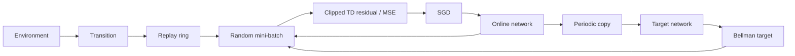

# 5. ZinnのCartPole DQNはどう学ぶのか

[← 前の章](04-reinforcement-learning.md) · [次の章 →](06-quantization-and-mcu.md) · [English](../en/05-cartpole-dqn.md)

この章では、経験、将来価値の学習目標、SGDを実コードへ結び付けます。

**DQN（Deep Q-Network）**はニューラルネットワークで行動の価値Qを推定する方法です。この例は正規化した4入力、16個のReLUを持つ隠れ層2つ、LEFTとRIGHTの線形Q出力2つで、パラメータは386個です。状態を2.4、3、12*pi/180、3.5でそれぞれ割り、[-1,1]へ制限します。

各ステップでε-greedyにより行動を選び、物理演算を進め、状態・行動・報酬・次状態・終了種別を**Transition（経験1件）**として保存します。**Replay Buffer**は最近の経験を保持するリングです。過去の経験をランダムに取り出すことで、連続ステップの強い偏りを和らげ、得た経験を繰り返し利用します。ただし、新しい独立した現実の経験が増えるわけではありません。

**Online Network**はSGDで更新するネットワークです。**Target Network**は定期的なコピーで、少しゆっくり変わる学習目標を作ります。両者を分けないと、予測と目標が更新のたびに同時に動いてしまいます。ReplayとTargetは安定化の助けになりますが、収束を保証するものではありません。

Bellman targetの意味は、「今受け取った報酬に、次の状態からまだ得られそうな最良の報酬を、割り引いて加える」です。**Discount factor（割引率）**γは遠い将来の影響を弱めます。報酬1、次状態の価値が2と4、γ=0.95なら、目標は1＋0.95×4＝**4.8**です。

その意味を式にすると`target = reward + gamma * max(Q_target(next))`です。物理的な失敗で終了した場合は未来がないのでtarget=rewardです。時間上限による打ち切りでは、最後の観測から将来価値を加えるbootstrapを行います。目標とOnlineの予測の差を**TD（Temporal Difference、時間差分）残差**と呼びます。

Zinnは選択した行動のTD残差を±1へ制限して仮の目標を作り、既存MSE Trainerへ渡します。そのバッチの非選択出力の残差はゼロですが、共有する隠れ層の更新で将来の両出力は変わり得ます。これはクリップした目標のMSEで、別実装のHuber LossやDouble DQNではありません。既定値はSGD 0.005、γ=0.95、バッチ32、Replay 10,000件、開始前512件、εは10,000ステップで1→0.05、Target同期は100回のSGD更新ごとです。

後半に性能が落ちることもあります。探索、Replayの分布の変化、動く価値目標が影響し合うためです。Zinnは別の開発用Episodeで最良Policyを保存し、最後のOnline値が最良とは仮定しません。試した学習率減衰は全seedを安定化できなかったため、通常の設定は維持しています。CheckpointはPolicyだけを保存し、Replay、乱数状態、Targetを含む学習セッション全体の再開用ではありません。



## Zinnでの実装

[DQN](../../../src/rl/dqn.zig)、[Replay](../../../src/rl/replay.zig)、[Episodeと選択](../../../examples/rl-cartpole/agent.zig)、[品質レポート](../../rl-cartpole-quality.md)で対応を確認できます。次のコマンドは元の2出力Qモデルを学習し、改善した1出力の整数行動マージンを生成します。DQNそのものを1出力学習へ変更するものではありません。`e2e`は整数参照との一致であり、Episode成功率ではありません。

<!-- zinn-cartpole-definition -->
```zig
const z = @import("zinn");
pub const Structure = z.Definition(4, &.{ .{ .units = 16, .activation = .relu }, .{ .units = 16, .activation = .relu }, .{ .units = 2 } });
```

## 試してみる

Zig 0.17.0を使い、リポジトリのルートから実行します。GUIコマンドはmacOS用です。

```sh
zig build --build-file examples/rl-cartpole/build.zig train evaluate e2e -Dpolicy-export=improved -Dprogress=plain
```

## 理解を確かめる

物理的終了で将来価値を加えない理由は何でしょうか。最良Checkpointが最後のOnline Networkより良いことがあるのはなぜでしょうか。
