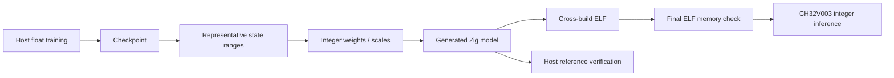

# 6. 量子化と極小マイコンでの推論

[← 前の章](05-cartpole-dqn.md) · [English](../en/06-quantization-and-mcu.md)

この章では、floatのモデルを整数ファームウェアにすると何が変わるかを学びます。

**Float32**は32ビットで実数の近似値を表します。**int8**は8ビットで−128〜127の整数を表します。**スケール**が実数と整数の単位をつなぎます。スケール0.1なら0.26は整数3へ丸められ、およそ0.3を表します。誤差は0.04です。表現範囲の外側は端の値へ固定する**飽和処理**を行います。飽和がなくても丸めによる誤差は生じます。

**Weight（重み）**は学習済みの倍率、**Bias（バイアス）**は学習済みのずれ、**Activation**は現在の入力に対する一時的な計算結果です。Zinnはint8重みを保持し、多数の積を安全に足すため、より広い**int32 Accumulator（累積値）**を使います。int32なら無限に足せるわけではなく、Zinnは最悪時の累積上限も検査します。既存の再量子化はint64の積、整数の丸め、飽和を使い、MCU推論では浮動小数点演算を行いません。**Workspace**は層の間で使い回す明示的な作業領域であり、重みの複製ではありません。

**Calibration（校正）**では、代表的な入力をホストで流して数値の範囲を調べます。学習後の量子化を**PTQ（Post-Training Quantization）**と呼びます。**Checkpoint**は再利用できるfloat学習モデルで、**Generated Model（生成モデル）**は整数パラメータと静的な推論定義を持つZigソースです。推論エンジンが演算を提供し、生成ファイルから新たに学習するわけではありません。

MNISTでは上位の数字のスコアが近いと、小さな誤差で分類が変わります。CartPoleではRIGHT−LEFTの符号が逆転すると行動が変わります。1回の行動の違いが次状態を変え、その後の軌道へ影響を広げます。同じ状態での行動一致率と、それぞれの独立した軌道でのRewardは別の指標です。

改善版CartPoleは元のQ Checkpointを維持します。ホストでReLUの正の範囲を揃え、校正時の平均誤差でbiasを補正し、細かい出力スケールのRIGHT−LEFTを1つ出力します。正ならRIGHT、ゼロ以下ならLEFTです。これは絶対的なQ価値でも確率でもありません。実数の数学で等価な変換も、float32では同点付近で差が出る場合があるため、測定結果を報告しています。

CH32V003はFlash 16 KB、SRAM 2 KBです。学習はホストに置きます。変更しない重みとプログラムはFlash、入力・出力・Workspace・スタックはSRAMに置きます。MCUには生成重み、整数コード、アプリのバッファ、Workspaceだけを配置します。最終ELFにはStartup、Runtime、アプリも含まれ、パラメータ容量だけの検査では不十分です。スタック予算は予約量であり、実測した最大使用量ではありません。CartPole Firmwareは固定入力ベクトルから行動を出す最小例で、ゲーム、物理、Replay、学習を含まず、実物の倒立振子制御器ではありません。

次の新しい最終評価seed群は、固定した方式の再現確認用です。結果を使って別候補を調整してはいけません。`firmware`は生成と容量検査であり、実機書込みではありません。実機遅延とスタックhigh-waterは未測定です。



## Zinnでの実装

[Exporter](../../../src/export.zig)、[整数丸め](../../../src/quant.zig)、[カーネル](../../../src/kernels)、[Workspace](../../../src/workspace.zig)、[CartPoleのホスト変換](../../../examples/rl-cartpole/policy_export.zig)、[Firmware](../../../examples/rl-cartpole/firmware.zig)で責務を分離しています。[品質レポート](../../rl-cartpole-quality.md)は古い記録を残し、Rewardの平均・中央値、成功率、行動一致、最終ELF容量を比較します。

## 試してみる

Zig 0.17.0を使い、リポジトリのルートから実行します。GUIコマンドはmacOS用です。

```sh
zig build --build-file examples/rl-cartpole/build.zig firmware -Dpolicy-export=improved
zig build --build-file examples/rl-cartpole/build.zig study -Dfinal-test=true -Dprogress=off
```

## 理解を確かめる

重み、Activation、Workspaceはそれぞれどこに置くのでしょうか。整数参照と一致してもfloatと同じ制御品質とは限らないのはなぜでしょうか。
