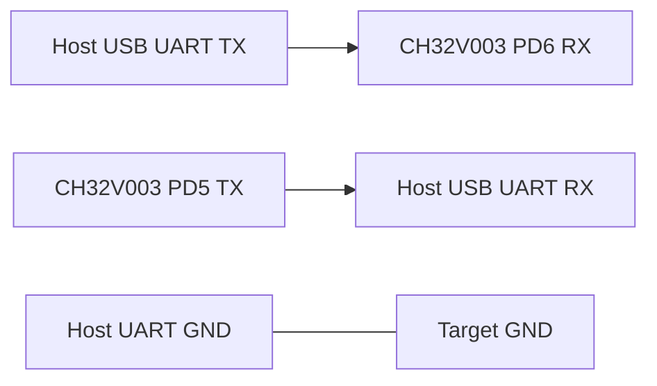

# Tutorial 4 — UART Inference

Start with [MNIST offline integration](mnist.md) or the [CSV package](csv-classifier.md). The reusable Service handles external quantized inputs and returns class plus every integer logit. Host simulation needs no UART. Physical operations below are opt-in and **not hardware-verified**.

## Host first

```sh
zig build deploy infer-host simulate-uart -Dproject=mnist -Dmnist-fixture=true -Dmnist-epochs=1 -Dapp-name=uart-demo -Drequest=benchmark
zig build check-response -Dexpected-json=zig-out/inputs/uart-demo-expected.json -Dresponse-bin=zig-out/reports/uart-demo-simulated-response.bin
```

The expected JSON contains model_id, sequence, class and all signed logits. The checker requires identity/opcode/CRC/status/class/all-logit agreement; reports live in zig-out/reports. A simulated clock is deliberately artificial. A response file cannot attest physical execution.

## Wiring and electrical assumptions

Default CH32V003 adapter: USART1 **PD5 TX / PD6 RX**,115200 baud,8 data bits,no parity,1 stop bit,no flow control. Check your exact package/board exposes both pins. Pin names are GPIO names, not package pin numbers. Use a3.3V-powered target and3.3V logic USB-UART for this setup, common ground and one agreed power source; do not connect RS-232-level signals or assume5V interoperability. Check board/regulator/adapter ratings before connecting power. No SWIO terminal is required for UART operation.



Mapping is checked against the default USART route in the [WCH USART example](https://github.com/openwch/ch32v003/tree/main/EVT/EXAM/USART/USART_Printf) and [WCH datasheet/reference manual](https://www.wch-ic.com/products/CH32V003); code is [the board adapter](../../src/targets/ch32v003_uart.zig) plus [upstream UART init](../../vendor/ch32fun_zig/src/hal/uart.zig). The vendor lists3.3V/5V rated operation, but that does not validate a particular board/adapter combination. The checked mapping/settings have not been exercised on hardware here.

## Physical firmware write — hardware required

For the exact offline-demo configuration above (chzig/WCH-LinkE additionally required):

```sh
zig build flash -Dproject=mnist -Dmnist-fixture=true -Dmnist-epochs=1 -Dapp-name=uart-demo -Drequest=benchmark
```

This is the explicit destructive device-write step; deploy only generates/checks firmware. Synthetic-fixture weights demonstrate transport, not real digit recognition. For a trained model use the same model/checkpoint/preprocessing/format options in deploy, flash and infer-host.

deploy's saved summary identifies the MCU, ELF/BIN and Flash/static RAM/stack
allowance/margin. These are build measurements/budgets, not physical inference
timing or stack high-water. e2e independently verifies integer reference outputs;
classification accuracy comes from evaluate. See the [CLI workflow](../cli.md).

## Exchange and check — hardware required

```sh
sh tools/uart-exchange.sh /dev/ttyUSB0 zig-out/inputs/uart-demo-request.bin response.bin
zig build check-response -Dexpected-json=zig-out/inputs/uart-demo-expected.json -Dresponse-bin=response.bin
```

Replace /dev/ttyUSB0 with the actual Linux or macOS serial device. The optional POSIX shell helper uses stty/dd, restores settings and bounds reads; it is not a required build dependency. Use stop-and-wait: wait for a whole response before sending another request. There is no receive interrupt queue; host retries and flow control are application responsibilities.

## Your input and errors

Use -Dinput-bin=/path/input.i8 with infer-host for exactly256 already-quantized MNIST bytes; it runs host inference and creates matching expected data/frame. Without that option it uses an embedded verification vector. Input is HWC16×16×1, signed i8 two's-complement, zero_point0. Apply the model's exact preprocessing and quantizeInput(value,input_scale) contract. Generated source and manifest expose scales; raw byte input is not resized or normalized by firmware.

infer performs no kernel timing instrumentation; benchmark requests report9 iterations with timer-overhead correction. info requests have no input and allow model_id0 discovery. CRC/model-id guard accidental mismatch only, not authentication. [Wire protocol](../api/uart.md) defines fields/statuses. Bad version/opcode/length/model/CRC, partial-frame timeout and hardware receive errors never run inference. The host checker fails on nonzero device status and prints the numeric code; no class-only fallback is accepted.

Cycles/high-water from a real capture require matching clock/power/firmware provenance. See [benchmark limitations](../benchmarks.md#hardware-measurements).
