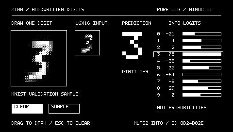

# MNIST desktop — Zinn + mimoc-ui

A small desktop integration example: draw one digit, get an integer prediction
immediately. The application owns its canvas, preprocessing, buffers and UI;
Zinn supplies the generated model. No UART or firmware is involved.



## Run

Requires Zig **0.17.0** and macOS with the Apple SDK/Command Line Tools. From the
repository root:

```sh
zig build --build-file examples/mnist-desktop/build.zig run -Doptimize=safe
```

The first build fetches the pinned mimoc-ui Git package. A real trained MLP32
int8 model is bundled, so launching requires **no dataset download or training**.
The UI dependency is isolated to this example; Zinn core/firmware dependencies
are unchanged. No local sibling checkout of mimoc-ui is required.

- Drag inside the 112x112 canvas with a mouse or trackpad. The prediction and
  16x16 model input update on changed strokes, including while the pen is down.
- CLEAR or Escape/Backspace/Delete removes the drawing and prediction.
- SAMPLE cycles through 16 bundled quantized validation inputs. Starting a stroke
  after a sample clears it. Samples check model integration; they are not a
  substitute for handwritten-input evaluation.
- Tab/Return also operate the buttons. Focus loss ends a stroke. Leaving the
  canvas breaks the segment so re-entry does not draw a connecting line.

This recognizes **digits 0–9**, not letters or arbitrary text. Logit bars show
raw int8 scores, **not probabilities or calibrated confidence**. Each frame's
bars are min-max normalized across its ten logits: the minimum is empty and the
maximum fills the 78px interior, with nearest-pixel integer rounding. All equal
logits produce empty neutral bars; the existing prediction tie-break/outline
stays unchanged. A negative logit can have a nonempty bar if it exceeds that
frame's minimum. Raw values, model outputs and classification accuracy are
unchanged. Top1-minus-top2 margin is available internally in raw logit units
(0 for a tied maximum), without adding another UI field. Blank input has
no prediction. Poorly shaped, incomplete or unfamiliar digits may be misclassified.

`zig build --build-file examples/mnist-desktop/build.zig -Doptimize=safe` installs
both zig-out/bin/zinn-mnist-desktop and an unsigned `Zinn MNIST.app` under this
example's zig-out directory. The logical 480x272 surface starts at 2x scale. Window
resizing clips/letterboxes this fixed surface; it does not resize the model input.
The current mimoc-ui native window backend is **macOS only**. Linux can run the
headless tests; no Linux graphical backend is claimed.

## Data path


Brush antialiasing and float preprocessing are host application code. The
inference call is the existing integer Model.infer with a fixed caller-owned
workspace. There is no inference or redraw on idle ticks. The drawing normalization
is an application heuristic to resemble MNIST, not an established accuracy claim
for mouse-written digits. The final 28→16 area weighting is tested against Zinn's
training preprocessing. All generated fixture logits are checked exactly.

## Tests and snapshot

```sh
zig build --build-file examples/mnist-desktop/build.zig test
zig build --build-file examples/mnist-desktop/build.zig test -Doptimize=safe
zig build --build-file examples/mnist-desktop/build.zig check -Dtarget=x86_64-linux-musl
zig build --build-file examples/mnist-desktop/build.zig run -Doptimize=safe -- --snapshot /tmp/mnist.pbm
```

The snapshot command renders a sample to PBM without opening a window. Test/check
work without AppKit or a display server. Tests cover blank/clear, edge clipping,
stroke interpolation, translation normalization, area weights, pointer lifecycle,
focus loss, immediate inference, all 16 fixture logits and a drawn seven.

## Train or replace the model

[Model definition](model.zig):256→32 ReLU→10. The bundled checkpoint and its
[provenance](assets/PROVENANCE.md) are included. Generated source is never edited
by hand. With real MNIST gzip files prepared using the repository downloader:

```sh
zig build mnist-download -Ddata-dir=/path/to/mnist
zig build --build-file examples/mnist-desktop/build.zig train -Dgenerate-model=true -Ddata-dir=/path/to/mnist -Doptimize=safe
zig build --build-file examples/mnist-desktop/build.zig generate -Dgenerate-model=true -Ddata-dir=/path/to/mnist -Doptimize=safe
zig build --build-file examples/mnist-desktop/build.zig run -Dgenerate-model=true -Ddata-dir=/path/to/mnist -Doptimize=safe
```

These use the shared addModel pipeline and cached host tools, with seed 42,
20 epochs, batch 32, learning rate 0.1, validation 5000, split seed 24301 and default
10-epoch×0.3 decay. No fitting occurs in the GUI process. To reuse the bundled
float checkpoint instead of training:

```sh
zig build --build-file examples/mnist-desktop/build.zig generate -Dgenerate-model=true -Ddata-dir=/path/to/mnist -Dcheckpoint=examples/mnist-desktop/assets/model.zinn -Doptimize=safe
zig build --build-file examples/mnist-desktop/build.zig desktop-mnist-e2e -Dgenerate-model=true -Ddata-dir=/path/to/mnist -Dcheckpoint=examples/mnist-desktop/assets/model.zinn -Doptimize=safe
```

The default app continues using bundled assets. Add -Dgenerate-model=true to run
with the fresh source. To deliberately replace the committed default, use the
same generation arguments with `refresh-bundle`; this explicitly updates
assets/model.zinn, model.json and mnist-mlp32-int8.zig. Normal build/run never
writes source assets. Recheck tests and provenance after replacement.

The Build script uses root_module.addImport with a target-specific inference
Module and the generated LazyPath; no MCU support or mimoc-ui fork is required.
See the [integration guide](../../docs/integration.md) and
[desktop verification record](../../docs/mnist-desktop.md).
